# Power Apps UI Kit

**Reusable canvas components. Shared design settings. A clear path to modern Microsoft UI.**

Build consistent Power Apps screens with ready-made UI patterns. This fork aims to make common changes, such as brand color, simple to manage from one place.

[Browse components](#component-catalog) · [Set up shared colors](docs/THEMING.md) · [Read the evaluation](docs/FORK-REVIEW.md) · [View the roadmap](docs/ROADMAP.md) · [Track the new components](docs/COMPONENT-EXPANSION.md)

> **Current status:** 15 component samples with a purple accent default, an editable shared palette, and a modernization plan. This fork has not yet completed its own Power Apps Studio validation.

The project is available under the [MIT License](LICENSE). Source copyright notices are retained there.

## The goal

Create a practical library of modern Power Apps components that makers can reuse across business applications.

- Use the purple, coral, red, and gray palette through shared settings and documented control colors.
- Use Microsoft modern controls and themes where their behavior fits.
- Keep each component's inputs, outputs, and events easy to understand.
- Support keyboard use, readable contrast, and responsive layouts.
- Publish tested versions with clear setup steps and known limits.

These are the project's targets. The [evaluation](docs/FORK-REVIEW.md) explains the gaps in the current samples.

## What you can configure today

A **design token** is a named value for a shared style, such as a brand color or spacing.

| Setting | Current coverage | What it changes |
| --- | --- | --- |
| `AccentColor` | Original 12 components | Selected accents, highlights, and focus colors |
| `Motion` | Original 12 components | Optional animations controlled by that property |
| `Theme` | 11 components | The component's own `"Light"` or `"Dark"` palette |
| `ContentColor` | Floating action button | Its main icon and label color |
| `Shape`, `CornerRadius` | Button | Pill by default, or rounded corners with an editable radius |
| `Design` record | Form field, Search and filter bar, Message banner | Shared colors, status pairs, and supported corner properties |
| Spacing and typography | Component-specific | A broader shared contract is planned |

`Theme` is currently a text input. It is not Microsoft's `App.Theme` object. Changing `AccentColor` does not replace every internal color.

### Default palette

Use white and quiet gray surfaces, deep purple actions, and restrained coral accents. Reserve reds for status and confirmation cues.

Open [COLOR-PALETTE.txt](COLOR-PALETTE.txt) for hex codes with `//` color-name comments and practical usage notes.

| Role | Default | Shared value |
| --- | --- | --- |
| Primary action | Deep purple `#463782` | `UiTheme.Accent` |
| Primary action text | White `#FFFFFF` | `UiTheme.OnAccent` |
| Secondary accent | Muted coral `#D88777` | `UiTheme.Secondary` |
| Text on coral | Ink `#292630` | `UiTheme.OnSecondary` |
| Main background | White `#FFFFFF` | `UiTheme.Background` |
| Secondary surface | Quiet gray `#F5F4F7` | `UiTheme.Surface` |
| Main text | Ink `#292630` | `UiTheme.Text` |
| Supporting text | Muted ink `#625F69` | `UiTheme.TextMuted` |

The original 12 component `AccentColor` defaults use `#463782`. The three new components accept `Design = UiTheme`. Native modern-control styling still follows supported properties and `App.Theme`; see each guide for coverage.

### Start with one theme record

Add the complete [theme formula](examples/theme/App.Formulas.powerfx) to **App.Formulas** in the host app. Edit its values to change the shared palette. A named formula recalculates when its dependencies change.

Use the complete linked formula so the `Design` record includes every required field. It includes separate error, warning, success, and information colors.

Set each inserted component's supported properties in Studio:

| Component property | Formula |
| --- | --- |
| `AccentColor` | `UiTheme.Accent` |
| `Theme`, where available | `UiTheme.Mode` |
| `Motion` | `UiTheme.Motion` |
| Floating action button `ContentColor` | `UiTheme.OnAccent` |
| Button `Shape` | `UiTheme.ButtonShape` |
| Button `CornerRadius` | `UiTheme.ButtonCornerRadius` |
| Form field, Search and filter bar, Message banner `Design` | `UiTheme` |

For host controls, bind screen `Fill` to `UiTheme.Background` and text `Color` to `UiTheme.Text`. Use `UiTheme.OnSecondary` for text placed on coral.

To follow the selected Microsoft theme instead, replace the `Accent` expression with `App.Theme.Colors.Primary`. This is an optional change; selecting a Microsoft theme does not override the literal defaults above.

White on purple has **9.86:1** contrast; ink on coral has **5.41:1**. Coral on white has only **2.74:1**, so use coral for decorative accents rather than text or required control indicators on white.

After editing the palette, run `python scripts/check_theme.py` to check the documented light-mode color pairs. See [theme validation](docs/THEMING.md) for limits and keyboard checks.

For this simple setup, set the navigation shell's `ShowThemeToggle` to `false` on a fresh instance. Its internal toggle can override its `Theme` input.

The starter has been checked against the declared properties and Microsoft documentation. It still needs validation in your Power Apps environment. Read [the full theme guide](docs/THEMING.md) before using it.

## Component catalog

Versions below identify the source baselines. This fork adds purple accent defaults, Button shape options, and three new patterns. Links open each component's source and setup guide.

| Component | Use | Version | Studio name |
| --- | --- | --- | --- |
| [Button](button/) | Pill or rounded corners; four action appearances | `0.3.1` | `lcsButton` |
| [Floating action button](floating-action-button/) | Main action and optional action menu | `0.3.0` | `lcsFab` |
| [KPI card](kpi-card/) | Value, comparison, and target progress | `0.1.0` | `lcsKpiCard` |
| [Data table](data-table/) | Table, cards, list, and row actions | `0.2.1` | `lcsDataTable` |
| [Kanban board](kanban-board/) | Work items grouped by stage | `0.1.0` | `lcsKanban` |
| [Month calendar](month-calendar/) | Dates and events | `0.1.0` | `lcsMonthCalendar` |
| [Attachments list](attachments-list/) | File staging and app-owned save actions | `0.2.0` | `lcsAttachmentList` |
| [Accordion](accordion/) | Expandable content sections | `0.1.0` | `lcsAccordion` |
| [Carousel](carousel/) | Slides with navigation and playback controls | `0.1.0` | `lcsCarousel` |
| [Navigation shell](navigation-shell/) | Side navigation and phone navigation | `0.2.0` | `lcsNavShell` |
| [Stepper](stepper/) | Form steps and progress | `0.3.1` | `lcsStepper` |
| [Tree view](tree-view/) | Expandable hierarchical items | `0.2.0` | `lcsTreeView` |
| [Form field](form-field/) | Labeled text entry with helper text and validation | `0.1.0` | `uiFormField` |
| [Search and filter bar](search-filter-bar/) | Query, status, and owner filters for host data | `0.1.0` | `uiSearchFilter` |
| [Message banner](message-banner/) | Persistent status messages and resolution actions | `0.1.0` | `uiMessageBanner` |

### Button shapes

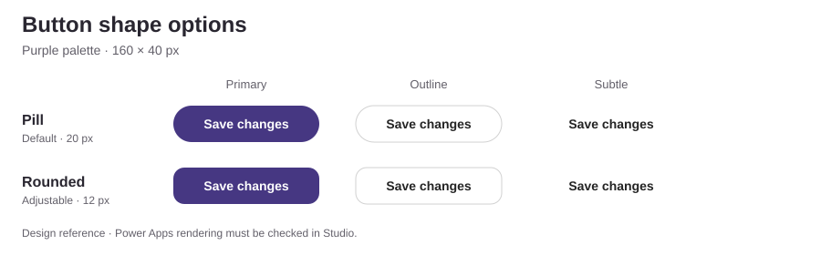

Static design reference, not a Power Apps screenshot. Pill is the default. Set `UiTheme.ButtonShape` to `"Rounded"` and adjust `UiTheme.ButtonCornerRadius` for rounded corners. See the [Button guide](button/README.md).

### Animated previews

These GIFs record the HTML gallery with sample data. They do not show native Power Apps controls; Studio validation remains pending.

Collapse the catalog below to hide motion. For interactions you control, download the repository and open the [browser gallery](preview/index.html) locally.

Show or hide animated previews

| Component demo | Component demo |
| --- | --- |
| [**Button**](button/)  | [**Floating action button**](floating-action-button/) 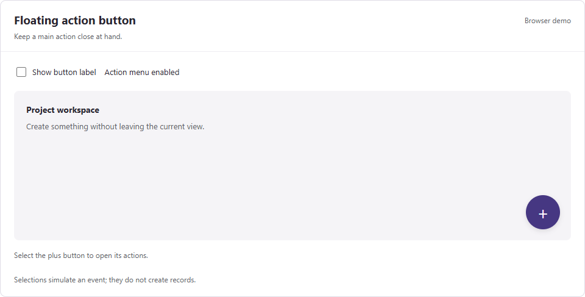 |
| [**KPI card**](kpi-card/)  | [**Data table**](data-table/) 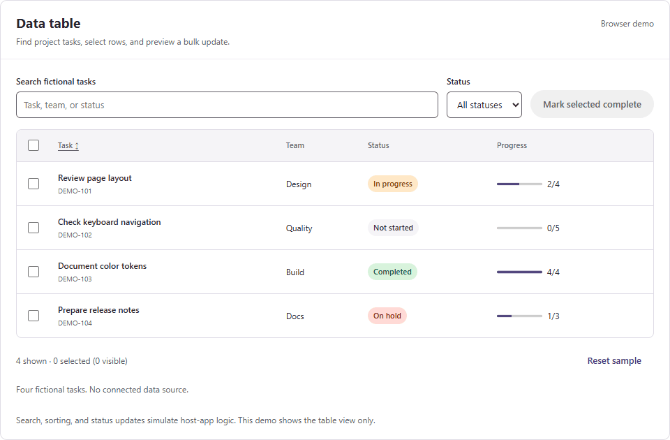 |
| [**Kanban board**](kanban-board/) 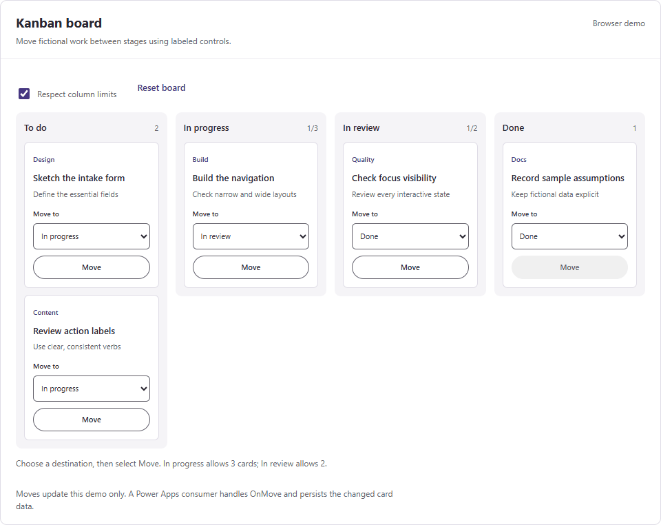 | [**Month calendar**](month-calendar/) 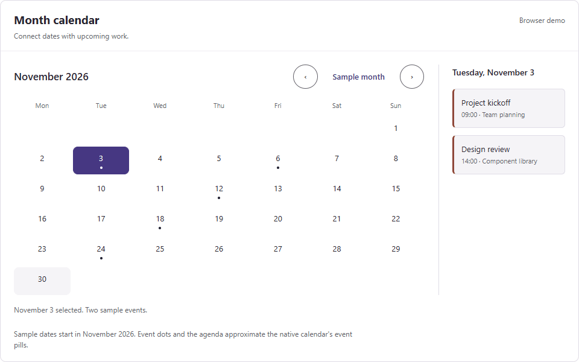 |
| [**Attachments list**](attachments-list/) 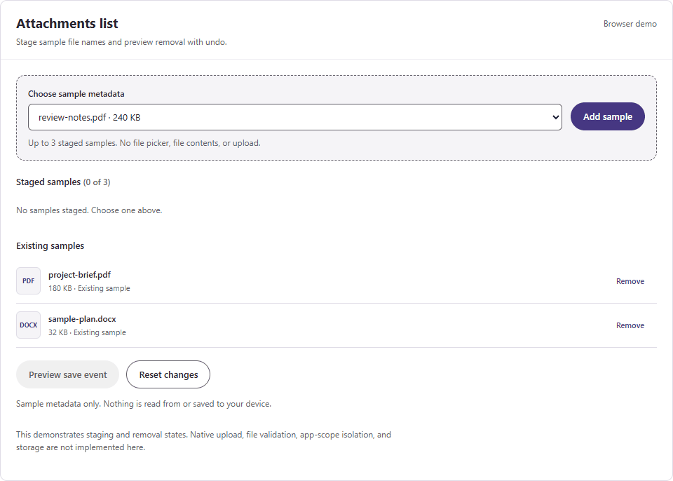 | [**Accordion**](accordion/) 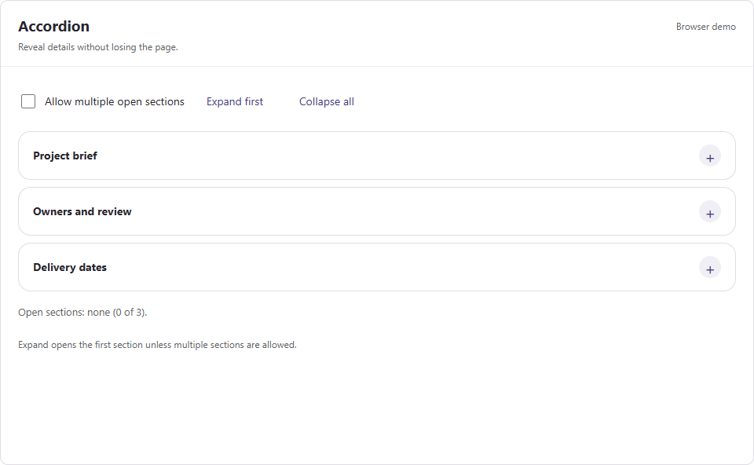 |
| [**Carousel**](carousel/) 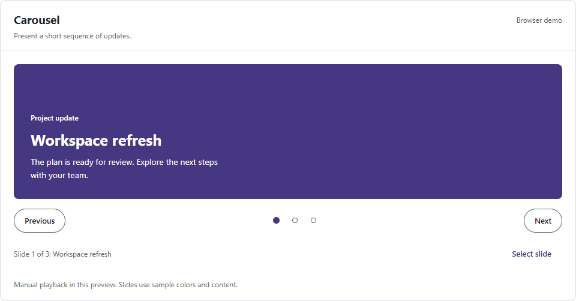 | [**Navigation shell**](navigation-shell/) 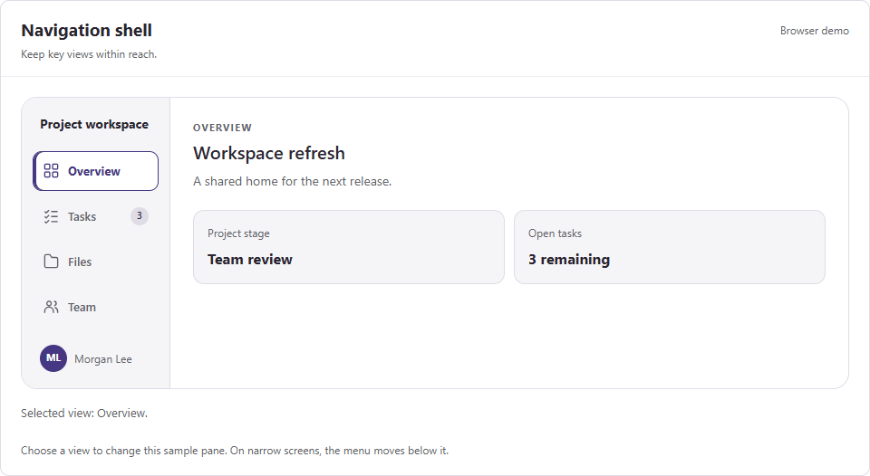 |
| [**Stepper**](stepper/) 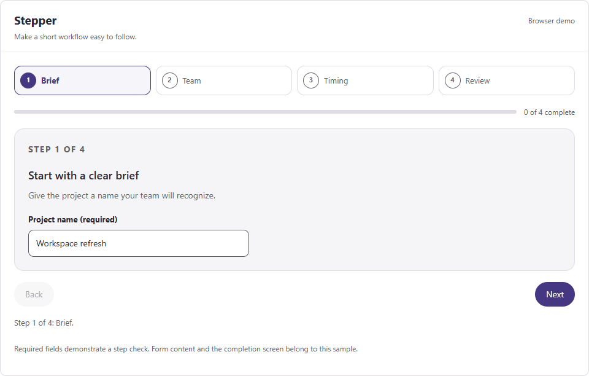 | [**Tree view**](tree-view/) 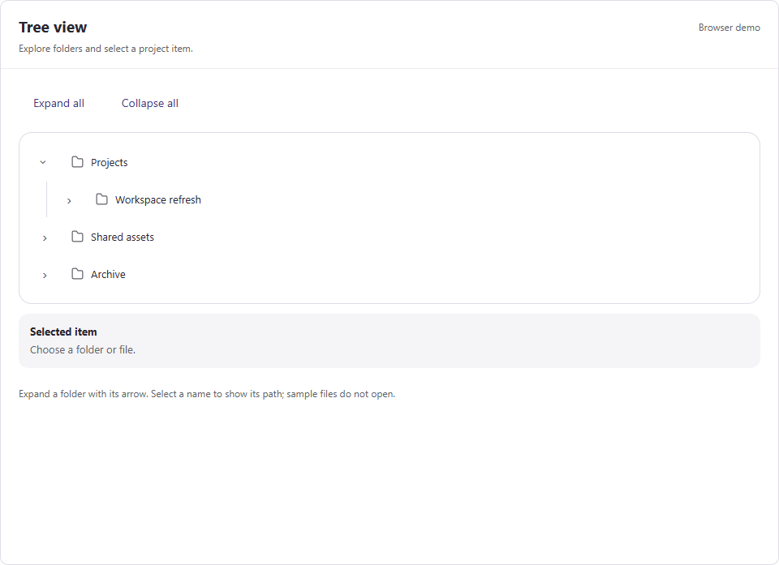 |
| [**Form field**](form-field/) 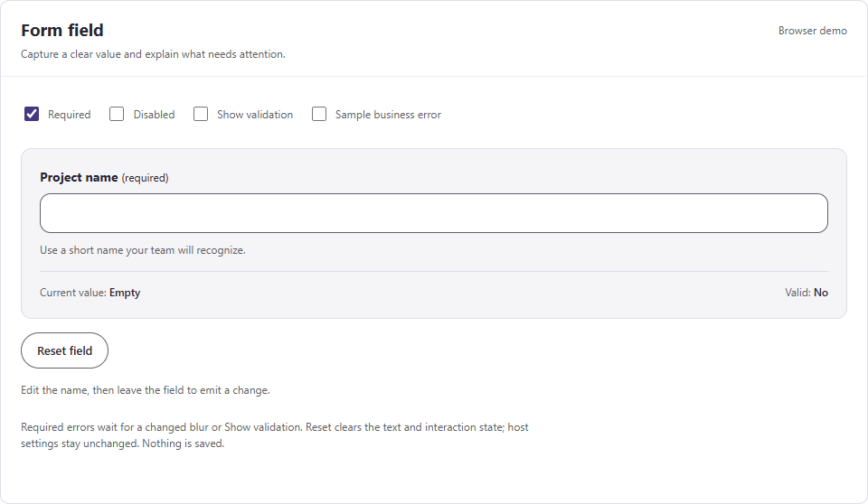 | [**Search and filter bar**](search-filter-bar/) 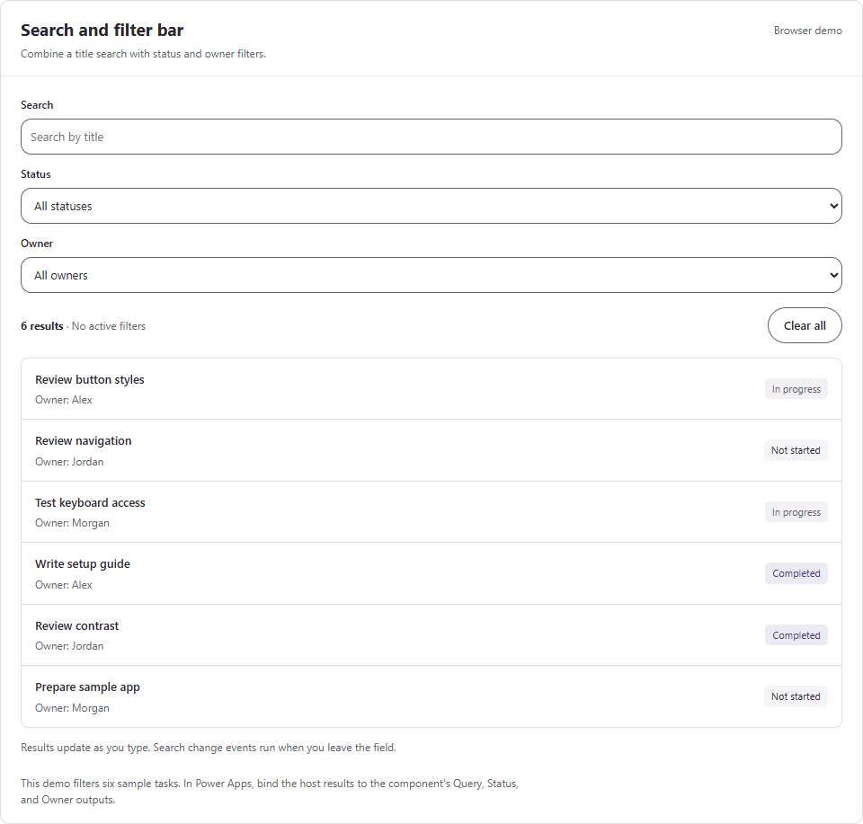 |
| [**Message banner**](message-banner/) 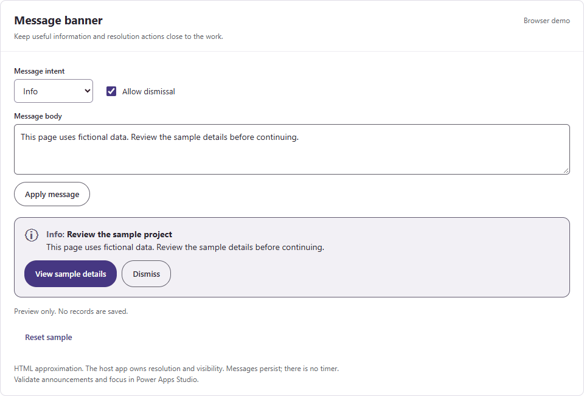 | |

## Preview before publishing

The [component gallery](preview/index.html) renders interactive HTML previews of all 15 components with sample data. Select a component, change the accent, and try its controls. Each preview links to its YAML source.

1. Download or clone this branch.
2. Open `preview/index.html` in your browser.
3. Select a component or search the catalog.
4. Adjust the controls and check the contrast result.
5. Validate the selected design in a development Power Apps app.

GitHub shows HTML source; open the downloaded file to run it. The preview runs locally without a build or publication step. Its controls change the preview only.

The gallery includes button states, action menus, KPI values, table selection, Kanban moves, calendar dates, sample attachments, accordions, slides, navigation, steps, tree selection, field validation, combined filters, and message actions. The [Button editor](preview/button.html) provides more detailed shape and color controls.

These HTML approximations do not execute Power Fx or render Microsoft's native controls. Generated palettes, focus behavior, events, and component imports still need Studio validation. Sample interactions stay in the page and do not save records.

Follow the [local validation guide](docs/VALIDATION.md) to run the source, contrast, and browser checks.

## Try a sample

1. Open a development canvas app in Power Apps Studio.
2. Read the selected component's setup guide.
3. Check its required controls and component properties in your environment.
4. Try the supplied YAML using the guide's import steps.
5. Bind its supported style properties to `UiTheme`.
6. Test its events, keyboard behavior, and layout before connecting production data.

The supplied files contain complete `ComponentDefinitions`. Their inherited paste instructions need fresh Studio verification. Microsoft documents code view for supported, Studio-generated YAML. Do not assume every YAML format can be pasted into every Studio surface. See [compatibility notes](docs/THEMING.md#compatibility-and-validation).

For reuse across apps, the intended delivery is a **component library**: a shared Power Apps asset with published updates. No packaged library or solution release is included yet.

## Design approach

We apply [Matt Pocock's module-design principles](https://github.com/mattpocock/skills/blob/main/docs/engineering/codebase-design.md) to the Power Apps implementation:

- **Small interface:** expose meaningful settings and events instead of every child control's styling property.
- **Local changes:** keep shared style decisions in one place, so a brand update does not require editing every component.
- **Explicit inputs:** pass data and theme values into reusable components; keep data access and saving in the host app.
- **Behavior checks:** verify the inputs, outputs, and events that an app actually uses.

Here, a module is the implementation behind a component's public interface. This is our application of Matt's guidance, not a Power Apps standard or certification from him.

## Roadmap

| Stage | Outcome | Status |
| --- | --- | --- |
| Foundation | Fork identity, source review, and configurable purple/coral defaults | Source changes available; Studio check pending |
| Theme pilot | Shared color, spacing, typography, and corner inputs in Button and KPI card | Planned |
| Reusable library | Versioned library, sample app, and solution packaging | Planned |
| Validated catalog | Remaining components meet documented release checks | Planned |

See the [roadmap and acceptance checks](docs/ROADMAP.md) for the work required before a component is called ready for production.

## Compatibility and support

The original 12 samples use modern controls; 11 also include classic controls. The three new patterns use modern controls and retain classic Labels for live announcements where needed. Search and filter bar uses the modern Dropdown preview. The project does not claim that every control is modern or generally available.

The attachments sample enables app-scope access and uses shared collections. Treat it as an app-level sample until library support and multiple-instance behavior are resolved.

The source license is MIT. Power Apps, connectors, data sources, and environments have separate licensing requirements.

Feedback belongs in this fork's [pull requests](https://github.com/dlpate2525/power_apps/pulls). Its issue tracker is currently disabled.

## Sources and attribution

Microsoft guidance was reviewed on **November 2, 2026**. Feature availability can vary by environment and release.

- [Modern themes and `App.Theme`](https://learn.microsoft.com/en-us/power-apps/maker/canvas-apps/controls/modern-controls/modern-theming)
- [Canvas component libraries](https://learn.microsoft.com/en-us/power-apps/maker/canvas-apps/component-library)
- [Canvas components and app scope](https://learn.microsoft.com/en-us/power-apps/maker/canvas-apps/create-component)
- [Power Apps code view](https://learn.microsoft.com/en-us/power-apps/maker/canvas-apps/code-view)
- [Detailed findings and sources](docs/FORK-REVIEW.md)

Copyright and permission notices are preserved in [LICENSE](LICENSE).

This is an independent community fork. It is not affiliated with or endorsed by Microsoft or Matt Pocock.
