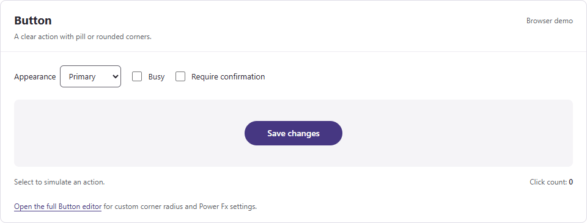
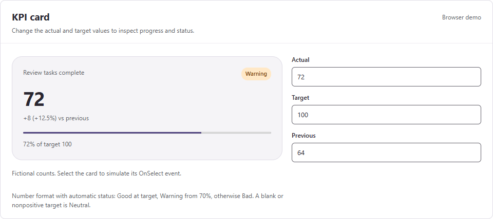

# Power Apps UI Kit

**Reusable canvas components. Shared design settings. A clear path to modern Microsoft UI.**

Build consistent Power Apps screens with ready-made UI patterns. This fork aims to make common changes, such as brand color, simple to manage from one place.

[Browse components](#component-catalog) · [Set up shared colors](docs/THEMING.md) · [Read the evaluation](docs/FORK-REVIEW.md) · [View the roadmap](docs/ROADMAP.md)

> **Current status:** 12 inherited component samples, a shared-theme starter, and a modernization plan. The component YAML is unchanged from upstream. This fork has not yet completed its own Power Apps Studio validation.

This project builds on [LowCodeStacks / power-apps-components](https://github.com/posiauday/power-apps-components), under the [MIT License](LICENSE). Original names, previews, and attribution are retained.

## The goal

Create a practical library of modern Power Apps components that makers can reuse across business applications.

- Change brand colors through shared settings.
- Use Microsoft modern controls and themes where their behavior fits.
- Keep each component's inputs, outputs, and events easy to understand.
- Support keyboard use, readable contrast, and responsive layouts.
- Publish tested versions with clear setup steps and known limits.

These are the project's targets. The [evaluation](docs/FORK-REVIEW.md) explains the gaps in the current samples.

## What you can configure today

A **design token** is a named value for a shared style, such as a brand color or spacing.

| Setting | Current coverage | What it changes |
| --- | --- | --- |
| `AccentColor` | All 12 components | Selected accents, highlights, and focus colors |
| `Motion` | All 12 components | Optional animations controlled by that property |
| `Theme` | 11 components | The component's own `"Light"` or `"Dark"` palette |
| `ContentColor` | Floating action button | Its main icon and label color |
| Spacing, corners, typography, status colors | Partial, component-specific | A complete shared contract is planned |

`Theme` is currently a text input. It is not Microsoft's `App.Theme` object. Changing `AccentColor` does not replace every internal color.

### Start with one theme record

Add this named formula to **App.Formulas** in the host app. A named formula recalculates when its dependencies change.

```powerfx
UiTheme = {
    Accent: App.Theme.Colors.Primary,
    Mode: "Light",
    Motion: false,
    OnAccent: ColorValue("#FFFFFF")
};
```

Set each inserted component's supported properties in Studio:

| Component property | Formula |
| --- | --- |
| `AccentColor` | `UiTheme.Accent` |
| `Theme`, where available | `UiTheme.Mode` |
| `Motion` | `UiTheme.Motion` |
| Floating action button `ContentColor` | `UiTheme.OnAccent` |

Choose a modern app theme to change the shared accent. Check contrast for your selected colors, including `OnAccent`.

For this simple setup, set the navigation shell's `ShowThemeToggle` to `false` on a fresh instance. Its internal toggle can override its `Theme` input.

The starter has been checked against the declared properties and Microsoft documentation. It still needs validation in your Power Apps environment. Read [the full theme guide](docs/THEMING.md) before using it.

## Component catalog

Versions below are inherited upstream versions. Links open the source and its original setup guide.

| Component | Use | Version | Studio name |
| --- | --- | --- | --- |
| [Button](button/) | Primary, secondary, outline, and subtle actions | `0.3.1` | `lcsButton` |
| [Floating action button](floating-action-button/) | Main action and optional action menu | `0.3.0` | `lcsFab` |
| [KPI card](kpi-card/) | Value, comparison, and target progress | `0.1.0` | `lcsKpiCard` |
| [Data table](data-table/) | Table, cards, list, and row actions | `0.2.1` | `lcsDataTable` |
| [Kanban board](kanban-board/) | Work items grouped by stage | `0.1.0` | `lcsKanban` |
| [Month calendar](month-calendar/) | Dates and events | `0.1.0` | `lcsMonthCalendar` |
| [Attachments list](attachments-list/) | File staging and app-owned save actions | `0.2.0` | `lcsAttachmentList` |
| [Accordion](accordion/) | Expandable content sections | `0.1.0` | `lcsAccordion` |
| [Carousel](carousel/) | Slides with navigation and playback controls | `0.1.0` | `lcsCarousel` |
| [Navigation shell](navigation-shell/) | Side navigation and phone navigation | `0.2.0` | `lcsNavShell` |
| [Stepper](stepper/) | Form steps and progress | `0.3.1` | `lcsStepper` |
| [Tree view](tree-view/) | Expandable hierarchical items | `0.2.0` | `lcsTreeView` |

### Upstream previews

These previews show the original LowCodeStacks samples. They do not demonstrate a completed theme migration in this fork.

| Button | KPI card |
| --- | --- |
| [](button/) | [](kpi-card/) |

Explore all original demos at [LowCodeStacks](https://lowcodestacks.com/components).

## Try a sample

1. Open a development canvas app in Power Apps Studio.
2. Read the selected component's setup guide.
3. Check its required controls and component properties in your environment.
4. Try the supplied YAML using the guide's import steps.
5. Bind its supported style properties to `UiTheme`.
6. Test its events, keyboard behavior, and layout before connecting production data.

The supplied files contain complete `ComponentDefinitions`. Their inherited paste instructions need fresh Studio verification. Microsoft documents code view for supported, Studio-generated YAML. Do not assume every YAML format can be pasted into every Studio surface. See [compatibility notes](docs/THEMING.md#compatibility-and-validation).

For reuse across apps, the intended delivery is a **component library**: a shared Power Apps asset with published updates. No packaged library or solution release is included yet.

## Design approach

We apply [Matt Pocock's module-design principles](https://github.com/mattpocock/skills/blob/main/docs/engineering/codebase-design.md) to the Power Apps implementation:

- **Small interface:** expose meaningful settings and events instead of every child control's styling property.
- **Local changes:** keep shared style decisions in one place, so a brand update does not require editing every component.
- **Explicit inputs:** pass data and theme values into reusable components; keep data access and saving in the host app.
- **Behavior checks:** verify the inputs, outputs, and events that an app actually uses.

Here, a module is the implementation behind a component's public interface. This is our application of Matt's guidance, not a Power Apps standard or certification from him.

## Roadmap

| Stage | Outcome | Status |
| --- | --- | --- |
| Foundation | Fork identity, source review, and shared accent setup | Documentation available; Studio check pending |
| Theme pilot | Shared color, spacing, typography, and corner inputs in Button and KPI card | Planned |
| Reusable library | Versioned library, sample app, and solution packaging | Planned |
| Validated catalog | Remaining components meet documented release checks | Planned |

See the [roadmap and acceptance checks](docs/ROADMAP.md) for the work required before a component is called ready for production.

## Compatibility and support

All 12 samples use modern controls; 11 also include classic controls. The project does not claim that every control is modern or generally available.

The attachments sample enables app-scope access and uses shared collections. Treat it as an app-level sample until library support and multiple-instance behavior are resolved.

The source license is MIT. Power Apps, connectors, data sources, and environments have separate licensing requirements.

Fork-specific feedback belongs in this fork's [pull requests](https://github.com/dlpate2525/power_apps/pulls). Its issue tracker is currently disabled. Original component questions can use the upstream project's support channels.

## Sources and attribution

Microsoft guidance was reviewed on **November 2, 2026**. Feature availability can vary by environment and release.

- [Modern themes and `App.Theme`](https://learn.microsoft.com/en-us/power-apps/maker/canvas-apps/controls/modern-controls/modern-theming)
- [Canvas component libraries](https://learn.microsoft.com/en-us/power-apps/maker/canvas-apps/component-library)
- [Canvas components and app scope](https://learn.microsoft.com/en-us/power-apps/maker/canvas-apps/create-component)
- [Power Apps code view](https://learn.microsoft.com/en-us/power-apps/maker/canvas-apps/code-view)
- [Detailed findings and sources](docs/FORK-REVIEW.md)

Original component code and preview assets: **LowCodeStacks**, copyright 2026. See [LICENSE](LICENSE).

This is an independent community fork. It is not affiliated with or endorsed by Microsoft or Matt Pocock.
