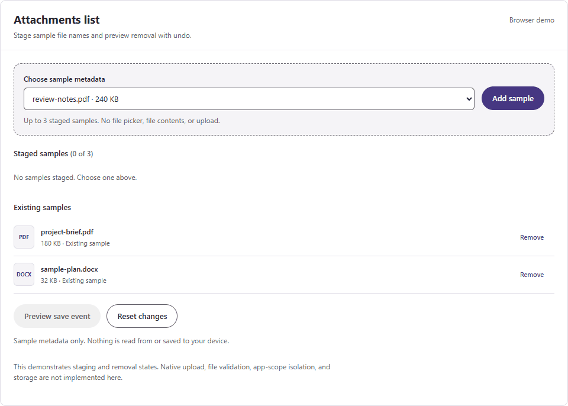

# Attachments list with upload

Stage new files and list existing attachments. The host app handles saving files and processing removals.

**Studio name:** `lcsAttachmentList`

**Original baseline version:** `0.2.0`

**License:** [MIT](../LICENSE)

**Status:** source-reviewed sample. Power Apps Studio import and runtime validation are pending.

The fork uses a configurable purple accent default. The original baseline version identifies the component's starting point.

The sample uses shared app collections. Validate two-instance behavior and host save handling before reuse.

## Browser demo

Recorded HTML demo with sample data. Native appearance and behavior still need Power Apps Studio validation.

Animated preview (hide/show)

Collapse the animation to hide motion. Use the [browser gallery](../preview/index.html) to try the controls at your own pace. Download the repository, then open the HTML file locally.

## Add it to your app

1. Open a development canvas app in Power Apps Studio.
2. Read the [current compatibility guidance](../docs/THEMING.md#compatibility-and-validation).
3. Check current settings for modern controls and enhanced component properties in your environment.
4. Try [component.yaml](component.yaml) using the import method supported by your Studio version.
5. Bind supported style inputs using the [shared theme setup](../docs/THEMING.md).
6. Verify the component's events, keyboard behavior, and layout in your app.

The YAML contains a complete `ComponentDefinitions` block. Confirm import support before using it in a production app.

[Component catalog](../README.md#component-catalog) · [Fork feedback and changes](https://github.com/dlpate2525/power_apps/pulls) · [MIT License](../LICENSE)
