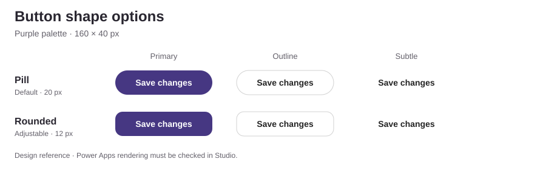
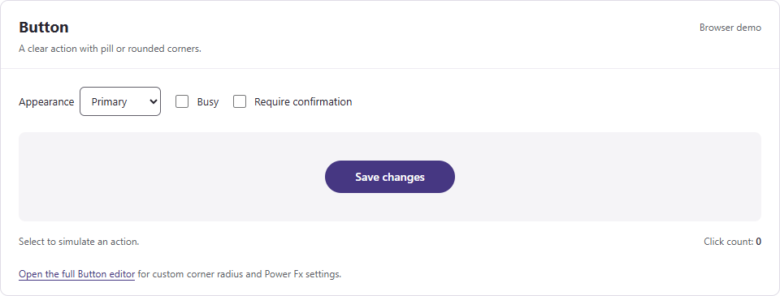

# Button

A purple action button with **pill corners by default** and an optional rounded shape. Choose Primary, Secondary, Outline, or Subtle appearance.

**Studio name:** `lcsButton` · **Source baseline:** `0.3.1` · [MIT License](../LICENSE)

Static design reference, not a Power Apps screenshot. Native appearance, focus, and interaction states still need Studio validation.

Use the [Button editor](../preview/button.html) to compare shapes and try color and state changes before publishing. Open the [component gallery](../preview/index.html) to explore all 15 components. Download the repository, then open either HTML file in a browser. These previews do not change the YAML source.

See the [complete property reference](../docs/COMPONENT-PROPERTIES.md#button) for inputs, defaults, outputs, events, and actions.

## Browser demo

Recorded HTML demo with sample data. Native appearance and behavior still need Power Apps Studio validation.

Animated preview (hide/show)

Collapse the animation to hide motion. Use the [browser gallery](../preview/index.html) to try the controls at your own pace. Download the repository, then open the HTML file locally.

## Choose the shape

| Input | Default | Behavior |
| --- | --- | --- |
| `Shape` | `"Pill"` | Use `"Pill"` or `"Rounded"`. Unknown values fall back to Pill. |
| `CornerRadius` | `12` | Rounded corner radius in pixels. Ignored for Pill. |
| `AccentColor` | `ColorValue("#463782")` | Shared primary color; bind it to `UiTheme.Accent`. |
| `Appearance` | `"Primary"` | Primary, Secondary, Outline, or Subtle. |

Pill uses half the smaller dimension. At the default 160 × 40 size, its radius is 20 pixels. Rounded uses `CornerRadius`, limited to zero through half the smaller dimension; a blank radius uses 12.

The native button and busy-animation clip use the same effective radius. Shapes apply to the existing appearances and interaction states.

## Use shared settings

Add [App.Formulas.powerfx](../examples/theme/App.Formulas.powerfx) to the host app. Bind these properties on each Button instance:

| Button property | Formula |
| --- | --- |
| `AccentColor` | `UiTheme.Accent` |
| `Shape` | `UiTheme.ButtonShape` |
| `CornerRadius` | `UiTheme.ButtonCornerRadius` |
| `Theme` | `UiTheme.Mode` |
| `Motion` | `UiTheme.Motion` |

Set `UiTheme.ButtonShape` to `"Rounded"` to change all bound buttons. Set `UiTheme.ButtonCornerRadius` to another number to adjust their corners. A local instance can override either input.

These are input bindings, not changes to the native Microsoft theme. The shared palette supports light mode; see [the theme guide](../docs/THEMING.md) before using dark mode.

## Add it to your app

**Status:** source-reviewed; import and runtime validation are pending.

1. Open a development canvas app in Power Apps Studio.
2. Check that modern controls and enhanced component properties are available.
3. Open the **Components** tab and create an empty component.
4. Select an empty area outside the component.
5. Copy [component.yaml](component.yaml) and try pasting it with **Ctrl+V**.
6. Confirm the definition imports without errors.
7. Insert `lcsButton` on a screen from **Insert > Custom**.
8. Bind the shared settings listed above.
9. Set `Label` and connect `OnClick` to the host action.

The file contains a complete `ComponentDefinitions` document. If your Studio version rejects this paste route, capture the error and verify its supported import format. See [compatibility notes](../docs/THEMING.md#compatibility-and-validation).

## Verify behavior

Keep the native button for keyboard activation and focus. Check both shapes with long labels, icons, narrow dimensions, and a visible focus indicator.

`IsBusy` disables the action. `RequireConfirm` enables select-again confirmation; its label provides a cue beyond color. Check both states and verify `OnClick` only runs as expected.

Microsoft's current [modern Button reference](https://learn.microsoft.com/en-us/power-apps/maker/canvas-apps/controls/modern-controls/modern-control-button) documents the four `Radius` properties used here. The size limit is this component's geometry rule.

[Back to the catalog](../README.md#component-catalog) · [Source](component.yaml) · [Feedback](https://github.com/dlpate2525/power_apps/pulls)
