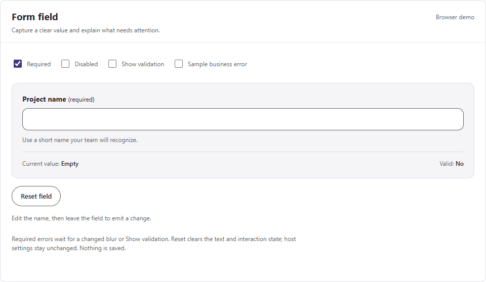

# Form field

A single-line text field with a visible label, helper text, and clear validation messages.

**Studio name:** `uiFormField` · **Version:** `0.1.0` · [MIT License](../LICENSE)

**Status:** source-reviewed sample. Power Apps Studio import, player behavior, screen-reader output, and library validation remain pending.

<details>
<summary>Show or hide the recorded browser demo</summary>



Recorded from the HTML preview with sample data. Native Power Apps validation is pending.

</details>

See the [complete property reference](../docs/COMPONENT-PROPERTIES.md#form-field) for inputs, defaults, outputs, events, and actions.

## Interface

| Input | Default | Purpose |
| --- | --- | --- |
| `Label` | `"Project name"` | Visible field name. Supply meaningful, nonblank text. |
| `DefaultText` | `""` | Starting text and the value restored by reset. |
| `HelperText` | Short naming instruction | Guidance below the input. Use `""` to omit it. |
| `Required` | `true` | Reject blank or whitespace-only text. |
| `ErrorText` | `""` | Host-supplied business error, shown immediately. The host clears it. |
| `ShowValidation` | `false` | Show required errors after a host validation attempt. |
| `Disabled` | `false` | Prevent editing without changing validity or clearing errors. |
| `Design` | Complete light palette | Shared colors and `CornerRadius`. Bind to `UiTheme`. |

| Output or event | Behavior |
| --- | --- |
| `Text` | Current text updates while typing. Whitespace is preserved. |
| `IsValid` | The required rule passes and `ErrorText` is blank. Independent of error visibility. |
| `OnChange(NewText)` | Runs after changed text loses focus. Receives the current text. |
| `Reset(instance)` | Restores `DefaultText` and clears the internal interaction flag through `OnReset`. |

The host owns business validation and saving. The component has no data source, app-scope access, shared collections, or storage.

## Validation behavior

An untouched required field is invalid, but its required message stays hidden. Show it after changed text loses focus or `ShowValidation` becomes true.

Focusing and leaving unchanged text does not trigger the native `OnChange` event. Use `ShowValidation` to check untouched fields before continuing.

`ErrorText` takes precedence over the required message. It remains visible until the host changes it. `Required = false` permits blank text when no host error exists.

Reset does not change host inputs. Clear `ShowValidation` and `ErrorText` in the host when a complete form reset needs to hide those errors.

## Bind the shared settings

1. Add [App.Formulas.powerfx](../examples/theme/App.Formulas.powerfx) to the host app.
2. Set the field instance's `Design` property to `UiTheme`.
3. Bind its label, starting value, and business error inputs.
4. Read `Text` and `IsValid` before the host performs its next action.

For an instance named `ProjectNameField`, use these property formulas:

```powerfx
// Design
UiTheme

// ShowValidation
varShowValidation

// ErrorText
varProjectNameError
```

A host check button can reveal errors without saving anything:

```powerfx
Set(varShowValidation, true)
```

A host reset button can clear its own validation state and reset the field:

```powerfx
Set(varShowValidation, false);
Set(varProjectNameError, "");
Reset(ProjectNameField)
```

Initialize the host variables before using these bindings. These formulas use English authoring separators.

The field consumes `Accent`, `Text`, `TextMuted`, `Background`, `Surface`, `ControlBorder`, `Error`, `ErrorSurface`, and `CornerRadius` from `Design`.

Corners are limited to zero through half the smaller input dimension. Blank radius uses 12 pixels. Native focus, hover, disabled, and validation styling can still depend on the platform theme.

## Add and verify

1. Open a development canvas app in Power Apps Studio.
2. Read the [compatibility guidance](../docs/THEMING.md#compatibility-and-validation).
3. Check modern controls and enhanced component properties in your environment.
4. Try [component.yaml](component.yaml) using a supported Studio import method.
5. Bind the inputs and event on an instance.
6. Check blank, whitespace, changed-blur, business-error, disabled, and reset behavior.
7. Check two instances, keyboard focus, long labels, and narrow layouts.

The source uses `ModernTextInput@1.0.0` with `Default` input and `Text` output. Older control versions may use different properties. The YAML is a complete `ComponentDefinitions` document; import compatibility is not proven by static checks.

This is a standalone field for custom screens. Microsoft does not support inserting canvas components into forms or galleries. Use a [native modern Form](https://learn.microsoft.com/en-us/power-apps/maker/canvas-apps/controls/modern-controls/modern-control-form) on the host screen for data-bound record editing and `SubmitForm` behavior.

The input's accessible label includes the field name, requirement, help, and displayed error. A classic Label stays visible with `Live.Polite` to announce changing errors. Error text provides a cue beyond color.

Native `Required` is deliberately false inside the input. The component applies its own required rule and explicit `ValidationState` to defer errors. Required status remains in the visible and accessible labels.

Keep enough component height for wrapping help and errors. Test the native focus indicator and screen-reader announcements in Studio; browser behavior is an approximation.

## Browser demo and sources

Open the [local gallery](../preview/index.html) after downloading the repository. Its sample field changes local state only and does not save records.

- [Microsoft: modern Text Input properties and change timing](https://learn.microsoft.com/en-us/power-apps/maker/canvas-apps/controls/modern-controls/modern-control-text-input)
- [Microsoft: component scope and limitations](https://learn.microsoft.com/en-us/power-apps/maker/canvas-apps/create-component)
- [Microsoft: live regions](https://learn.microsoft.com/en-us/power-apps/maker/canvas-apps/accessible-apps-live-regions)

[Component catalog](../README.md#component-catalog) · [Source](component.yaml)
