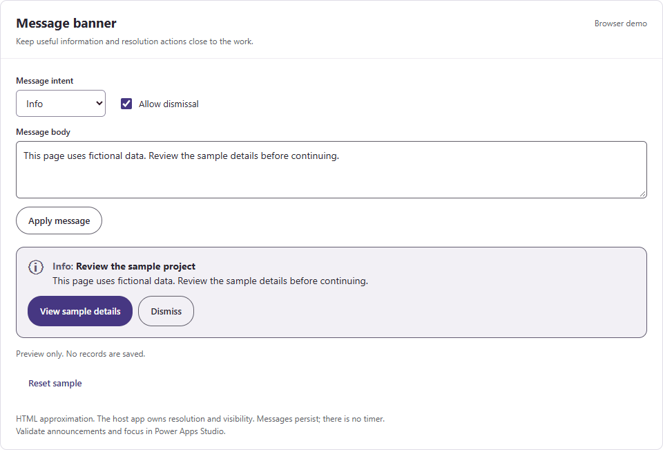

# Message banner

A persistent message with a status icon, text label, optional action, and optional Dismiss button.

**Studio name:** `uiMessageBanner` · **Draft version:** `0.1.0` · [MIT License](../LICENSE)

**Status:** source reviewed; Power Apps Studio import, runtime, and screen-reader validation are pending. This is a new canvas component, not Microsoft's native MessageBar.

Open the [browser gallery](../preview/index.html) locally to try the HTML approximation. The preview changes fictional data in memory only.

<details>
<summary>Show or hide the recorded browser demo</summary>



Recorded from the HTML preview with sample data. Native Power Apps validation is pending.

</details>

See the [complete property reference](../docs/COMPONENT-PROPERTIES.md#message-banner) for inputs, defaults, outputs, events, and actions.

## Interface

| Property | Type | Contract |
| --- | --- | --- |
| `Title` | Text input | Optional short heading. Default: `"Review the sample project"`. |
| `Message` | Text input | Message body. Supply meaningful text; it wraps and increases the measured height. |
| `Intent` | Text input | `"Info"`, `"Success"`, `"Warning"`, or `"Error"`. Blank and unknown values use Info. |
| `ActionLabel` | Text input | Blank hides the action. Use a short action phrase, preferably 24 characters or fewer. |
| `Dismissible` | Boolean input | Default `true`. Shows the Dismiss button; it does not hide the component itself. |
| `Design` | Record input | Bind the complete shared `UiTheme` record. Do not pass an incomplete record. |
| `ContentHeight` | Number output | Measured label and button height, including spacing. Bind instance `Height` to `Self.ContentHeight`. |
| `OnAction` | Event | Runs the host action without changing the component's inputs or visibility. |
| `OnDismiss` | Event | Requests dismissal. The host owns `Visible`, focus, and any later return of the message. |

The component uses no app-scope access, global variables, shared collections, or timers. Its built-in `Visible` property belongs to the host app.

## Add it to an app

1. Open a development canvas app in Power Apps Studio.
2. Check that modern controls and enhanced component properties are available.
3. Try the [component YAML](component.yaml) using your environment's supported component import route.
4. Confirm that the definition imports without errors.
5. Insert `uiMessageBanner` on a screen.
6. Add the shared [theme formula](../examples/theme/App.Formulas.powerfx) to `App.Formulas`.
7. Bind `Design` to `UiTheme`.
8. Bind `Height` to `Self.ContentHeight`.
9. Set the content inputs and connect both events to host formulas.

The file contains a complete `ComponentDefinitions` document. This format still needs import verification. See the [compatibility guide](../docs/THEMING.md#compatibility-and-validation).

## Resolve and dismiss different conditions

Use actions that address the reason for a Warning or Error. Dismissal removes the message from view; it does not fix a failed save or missing field.

This example changes a local sample value. It does not save a record. Name the instance `ProjectMessage` and add a host button named `btnShowBanner`.

Set the screen's `OnVisible` property:

```powerfx
UpdateContext({locBannerVisible: true, locProjectName: ""})
```

Bind these properties on `ProjectMessage`:

| Property | Formula |
| --- | --- |
| `Visible` | `locBannerVisible` |
| `Title` | `If(IsBlank(locProjectName), "Project name is missing", "Sample project name added")` |
| `Message` | `If(IsBlank(locProjectName), "Add a sample name to continue this example.", "The local sample project is named " & locProjectName & ". No record was saved.")` |
| `Intent` | `If(IsBlank(locProjectName), "Error", "Success")` |
| `ActionLabel` | `If(IsBlank(locProjectName), "Add sample name", "")` |
| `OnAction` | `UpdateContext({locProjectName: "Demo review"})` |
| `OnDismiss` | `UpdateContext({locBannerVisible: false}); SetFocus(btnShowBanner)` |
| `Width` | `Parent.Width - 32` |
| `Height` | `Self.ContentHeight` |
| `Design` | `UiTheme` |

Keep `btnShowBanner` visible. Set its text to `"Show message again"` and its `OnSelect` to `UpdateContext({locBannerVisible: true})`.

For a real save, update the banner only after the host confirms the result. Keep unresolved conditions in host state and decide when to show them again.

## Shared style settings

The complete `Design` default matches the shared theme. The banner reads these fields:

| Fields | Use |
| --- | --- |
| `Error`, `ErrorSurface` | Error icon, border, and background |
| `Warning`, `WarningSurface` | Warning icon, border, and background |
| `Success`, `SuccessSurface` | Success icon, border, and background |
| `Info`, `InfoSurface` | Info icon, border, and background |
| `Text` | Message and dismissal text |
| `Accent`, `OnAccent` | Action palette and label |
| `ControlBorder` | Dismiss button border |
| `CornerRadius` | Banner corners; default 12 pixels |
| `ButtonShape`, `ButtonCornerRadius` | Action and Dismiss corners; Pill by default |

Each radius is limited to half the smaller control dimension. Unknown button shapes use Pill. A blank rounded radius uses 12 pixels.

Other theme fields keep the shared record compatible; they do not change this component. `Mode` does not enable dark mode here. No animation uses `Motion`.

Modern buttons generate some interaction colors from `BasePaletteColor`. Check their hover, pressed, focus, and contrast behavior in Studio after changing the theme.

## Height and responsive layout

Use a component width of at least 240 pixels. Its default width is 640 pixels. The host must allow its height to grow.

- The outer padding is 16 pixels. The icon is 24 pixels wide, followed by a 12-pixel gap.
- Text starts at x = 52. Its available width is `Width - 68`.
- The wrapping label uses `AutoHeight`. Actions start 12 pixels below its measured bottom edge.
- Each button is 44 pixels high. Below 480 pixels, buttons fill the available width and stack with an 8-pixel gap.
- At 480 pixels or wider, buttons share a row. The action width is limited to 240 pixels; Dismiss uses 120 pixels.
- `ContentHeight` is the lowest visible content edge plus 16 pixels. It does not depend on the component's height.

Do not put the instance in a fixed-height parent that clips growing content. Position following controls from `ProjectMessage.Y + ProjectMessage.Height`.

A hidden Label does not update its measured height. Recheck layout when the banner becomes visible after its text or width changes. This is a documented [Label behavior](https://learn.microsoft.com/en-us/power-apps/maker/canvas-apps/controls/control-text-box).

## Validate in Studio

1. Import the component and check every formula for errors.
2. Test Info, Success, Warning, Error, blank, and unknown intent values.
3. Check long messages at 240, 320, 479, 480, and 640 pixels wide.
4. Change the text while hidden and check its measured height after showing it.
5. Hide each optional button and confirm that no extra row remains.
6. Use Tab, Enter, and Space to activate each visible button.
7. Dismiss the banner and confirm that focus reaches the host's chosen control.
8. Change the message with a screen reader running and check the full announcement.
9. Test two instances and confirm that neither changes the other's visibility or content.
10. Check text, icon, border, and native button contrast after a theme change.

The visible classic Label contains the intent, title, and message. Warning and Error use `Live.Assertive`; Info and Success use `Live.Polite`. The icon is decorative.

Use Warning and Error only when their interruptions are justified. The banner has no automatic dismissal and does not block other app controls itself.

## References

- [Fluent message bar guidance](https://fluent2.microsoft.design/components/web/react/core/messagebar/usage): intent, actions, wrapping, and announcement severity.
- [Power Apps Label](https://learn.microsoft.com/en-us/power-apps/maker/canvas-apps/controls/control-text-box): `AutoHeight`, `Wrap`, and `Live`.
- [Modern Button](https://learn.microsoft.com/en-us/power-apps/maker/canvas-apps/controls/modern-controls/modern-control-button): native actions, palettes, and corners.
- [Modern Icon](https://learn.microsoft.com/en-us/power-apps/maker/canvas-apps/controls/modern-controls/modern-control-icon): decorative icons and accessible labels.

[Back to the catalog](../README.md#component-catalog) · [Source](component.yaml) · [Feedback](https://github.com/dlpate2525/power_apps/pulls)
