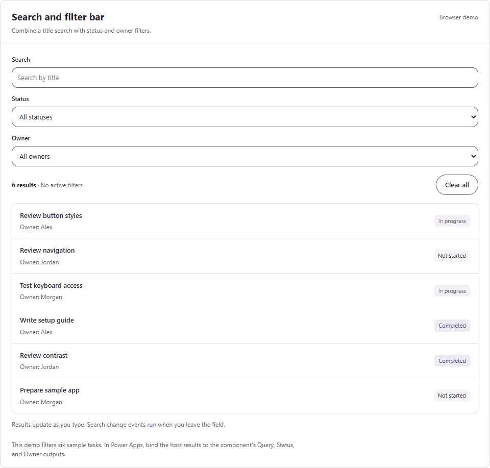

# Search and filter bar

Search by text and narrow results by status and owner. The component exposes filter values; the host app owns records and filtering.

**Studio name:** `uiSearchFilter` · **Version:** `0.1.0` · **Status:** source draft; Studio import and runtime validation pending. · [MIT License](../LICENSE)

**Preview dependency:** Microsoft's current control index labels modern Dropdown as preview. Confirm availability and suitability in the target environment. [Modern controls reference](https://learn.microsoft.com/en-us/power-apps/maker/canvas-apps/controls/modern-controls/modern-controls-reference)

The browser demonstration uses sample data. Open the [interactive gallery](../preview/index.html) to try the controls.

<details>
<summary>Show or hide the recorded browser demo</summary>



Recorded from the HTML preview with sample data. Native Power Apps validation is pending.

</details>

See the [complete property reference](../docs/COMPONENT-PROPERTIES.md#search-filter-bar) for inputs, defaults, outputs, events, and actions.

## Property contract

| Property | Kind | Default and meaning |
| --- | --- | --- |
| `StatusOptions` | Input table | `{Value: Text}` rows; default: Not started, In progress, Completed |
| `OwnerOptions` | Input table | `{Value: Text}` rows; default: Alex, Jordan, Morgan |
| `SearchPlaceholder` | Input text | `"Search by title"`; describe the host search rule |
| `ResultCount` | Input number | `-1` hides the result count; supply the full filtered count when known |
| `Disabled` | Input Boolean | `false`; disables controls while retaining their values |
| `Design` | Input record | Complete `UiTheme` record |
| `Query` | Output text | Search text, with leading and trailing spaces removed |
| `Status`, `Owner` | Output text | Selected `Value`; `""` means All |
| `ActiveFilterCount` | Output number | Count of nonempty query, status, and owner values: 0–3 |
| `OnChange` | Event | Edited search loses focus, or a dropdown selection changes |
| `OnClear` | Event | User selects Clear all after the controls reset |

Supply distinct, nonempty option values. The component adds an empty choice labeled **All statuses** or **All owners**. Blank selections also produce `""`.

`Query` updates on each keystroke. Bind results directly to outputs for live filtering. Text `OnChange` fires on blur; it is not a per-keystroke event. [Microsoft Text Input](https://learn.microsoft.com/en-us/power-apps/maker/canvas-apps/controls/modern-controls/modern-control-text-input)

## Add the component

1. Open a development canvas app with modern controls and enhanced component properties.
2. Try [component.yaml](component.yaml) using the [supported import guidance](../docs/THEMING.md#compatibility-and-validation).
3. Insert the component and name the instance `SearchFilter1`.
4. Set `Design` to the complete shared `UiTheme` record.
5. Bind `StatusOptions` and `OwnerOptions` to small option tables.
6. Bind the host results to `Query`, `Status`, and `Owner`.
7. Set the component width to at least 320 pixels.

The controls stack below 680 pixels. The summary wraps and grows with its text. Keep the calculated component height so every row remains visible. The component does not enable app scope or create shared collections.

## Try an in-memory example

Add this named formula to **App.Formulas**:

```powerfx
SampleTasks = Table(
    {Title: "Review button styles", Status: "In progress", Owner: "Alex"},
    {Title: "Review navigation", Status: "Not started", Owner: "Jordan"},
    {Title: "Test keyboard access", Status: "In progress", Owner: "Morgan"},
    {Title: "Write setup guide", Status: "Completed", Owner: "Alex"},
    {Title: "Review contrast", Status: "Completed", Owner: "Jordan"},
    {Title: "Prepare sample app", Status: "Not started", Owner: "Morgan"}
);
```

Add this second named formula to **App.Formulas**:

```powerfx
FilteredTasks = Filter(
    SampleTasks As task,
    IsBlank(SearchFilter1.Query) || StartsWith(task.Title, SearchFilter1.Query),
    IsBlank(SearchFilter1.Status) || task.Status = SearchFilter1.Status,
    IsBlank(SearchFilter1.Owner) || task.Owner = SearchFilter1.Owner
);
```

All three conditions must match. Search uses a title prefix, not a substring. [Microsoft Filter reference](https://learn.microsoft.com/en-us/power-platform/power-fx/reference/function-filter-lookup)

Set the host gallery's `Items` to `FilteredTasks`. Display `CountRows(FilteredTasks)` in a separate classic Label with `Live = Live.Polite`. Leave `SearchFilter1.ResultCount` at `-1` for this example.

Feeding a count derived from component outputs back into the same component can create a circular reference with multiple instances. Microsoft documents this limitation. Use `ResultCount` only with an independent host value or after validating the intended binding with two instances. [Component limitations](https://learn.microsoft.com/en-us/power-apps/maker/canvas-apps/create-component#known-limitations)

Before replacing `SampleTasks` with a connector, verify that its text columns support this `Filter` and `StartsWith` query. Choice and person columns need connector-specific comparisons. Do not assume a loaded gallery count represents all matching records. Check delegation warnings and test records beyond the app's local row limit. [Microsoft delegation guidance](https://learn.microsoft.com/en-us/power-apps/maker/canvas-apps/delegation-overview)

## Theme and reset

`Design` controls field colors and `CornerRadius`, plus the Clear all button's shape. It reads `Accent`, `Background`, `Text`, `TextMuted`, and `ControlBorder`. Native generated palettes still need rendered contrast checks.

Use `Reset(SearchFilter1)` to clear all values from the host. The visible Clear all button also emits `OnClear`. Native child controls own their values; two instances must be checked for isolation.

The HTML demo returns focus to Search after Clear all. The YAML does not force focus because Microsoft documents that `SetFocus` cannot target controls inside a component. Check native keyboard order in Studio. [SetFocus limitations](https://learn.microsoft.com/en-us/power-platform/power-fx/reference/function-setfocus)

The internal summary uses a persistent classic Label with `Live.Polite` for active-filter and optional result-count updates. Verify announcements in Studio. [Live regions](https://learn.microsoft.com/en-us/power-apps/maker/canvas-apps/accessible-apps-live-regions)

## Validate before reuse

1. Confirm `ModernTextInput@1.0.0` and `ModernDropdown@1.0.0` import in the target Studio version.
2. Verify an empty query and both All choices show every sample row.
3. Combine a query, status, and owner to check AND filtering.
4. Verify zero results and Clear all.
5. Confirm live `Query` updates separately from the search blur event.
6. Check reset, disabled controls, two instances, narrow layouts, and keyboard labels.

The current [Microsoft Dropdown reference](https://learn.microsoft.com/en-us/power-apps/maker/canvas-apps/controls/modern-controls/modern-control-dropdown) uses a `{Value: ...}` record for `Default` in its serialized example. This component follows that example for the empty All choice. Generic YAML parsing does not validate Power Fx execution.
